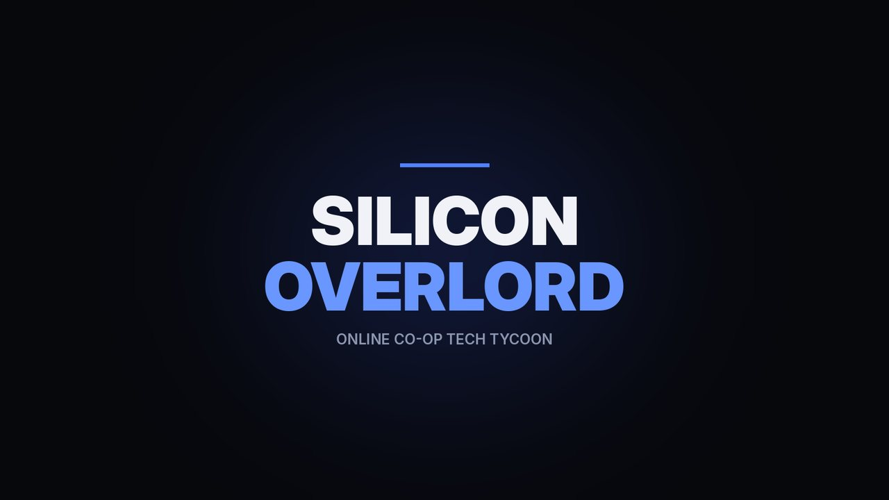
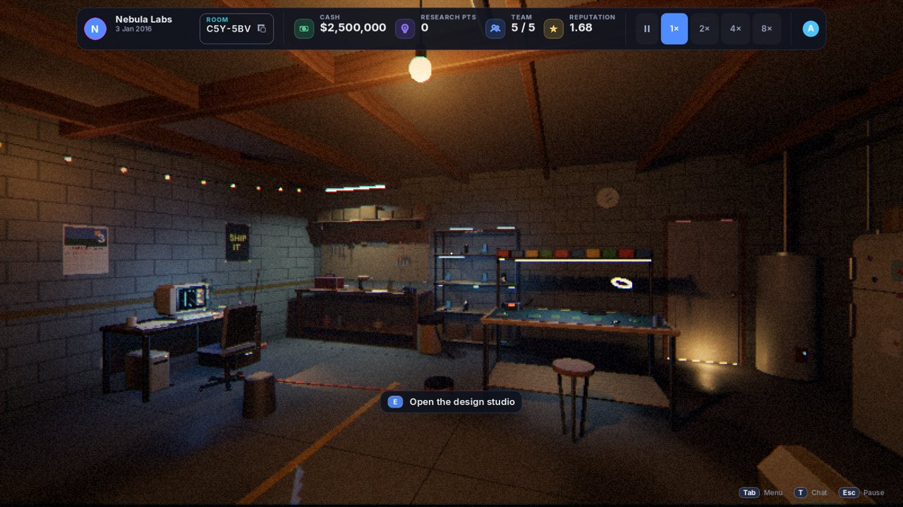
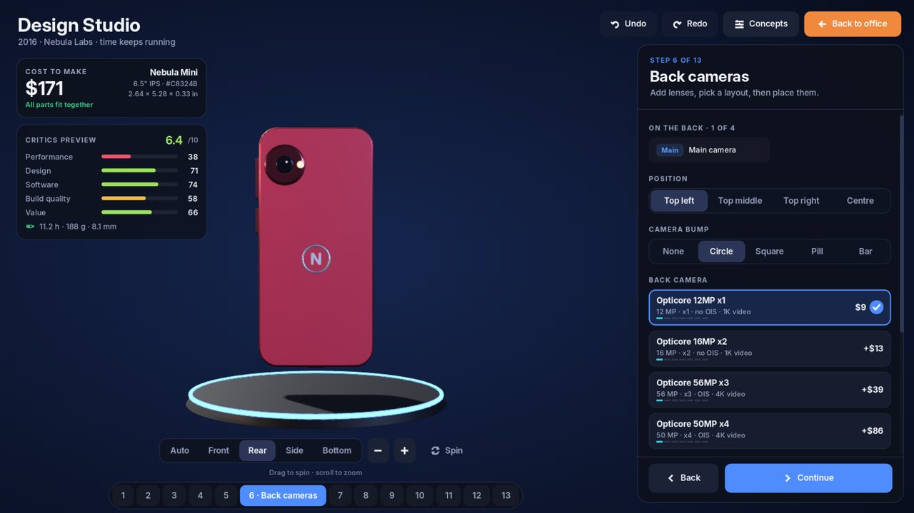
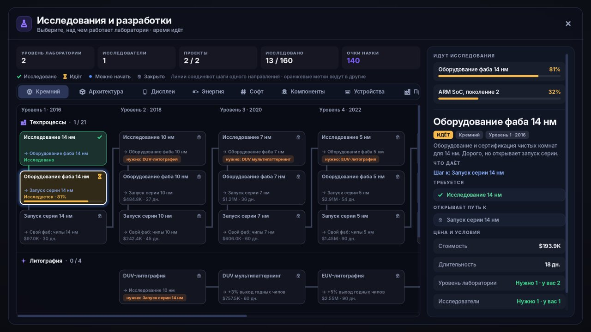
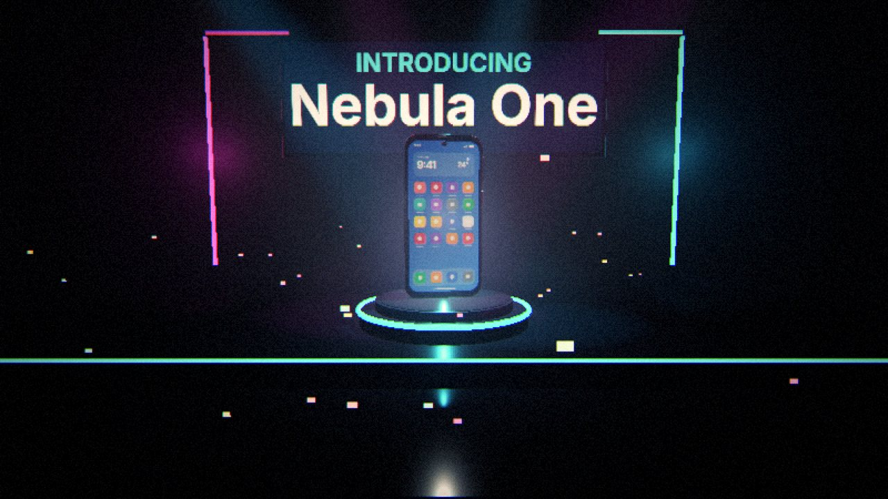
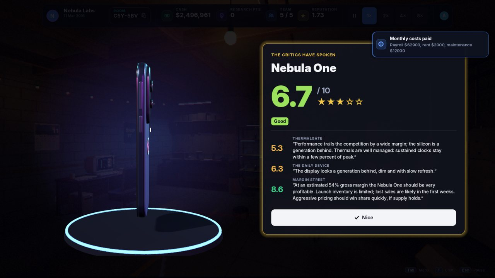
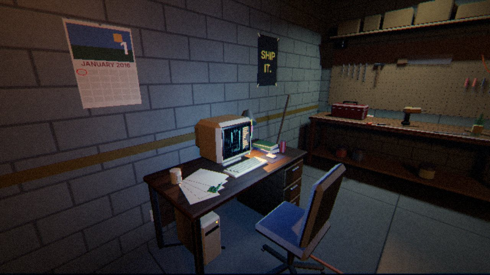
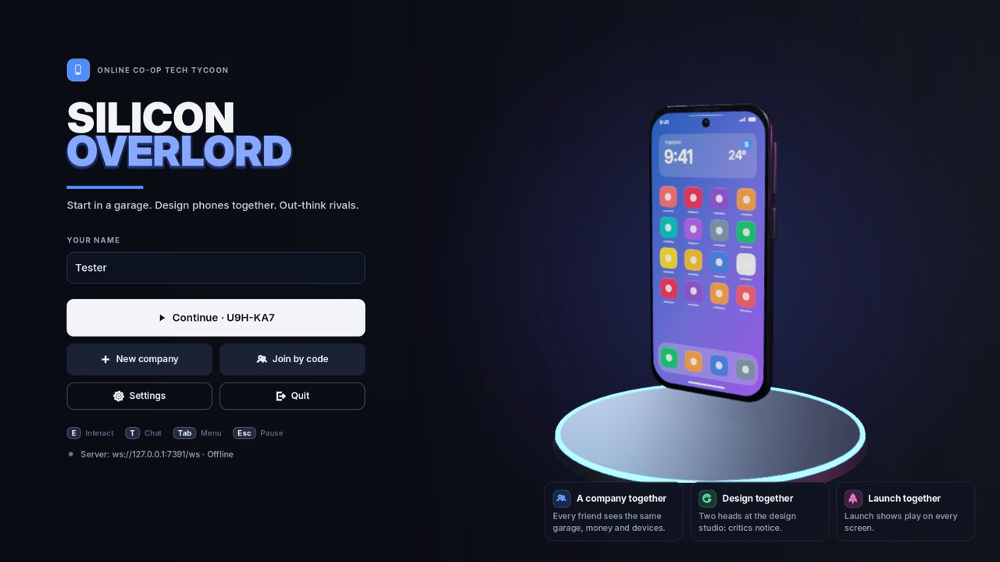

<p align="center">
  
</p>

<p align="center">
  <b>Онлайн-кооператив про технокомпанию.</b> Начни в тёмном гараже, собери свой первый телефон,
  выведи его на сцену перед критиками и построй империю вместе с друзьями.
</p>

<p align="center">
  <a href="https://github.com/inkoffTTV/silicon-overlord/releases/latest/download/SiliconOverlord.zip"><b>⬇ Скачать для Windows</b></a>
  &nbsp;·&nbsp; <a href="#как-играть">Как играть</a>
  &nbsp;·&nbsp; <a href="#свой-сервер">Свой сервер</a>
  &nbsp;·&nbsp; <a href="#english">English</a>
</p>

---



## Об игре

- **Вид от первого лица, атмосфера в духе R.E.P.O.** Тусклый гараж, живой свет ламп и мониторов,
  зернистая картинка. Любой предмет можно взять, покрутить и бросить.
- **Дизайн телефона в 13 шагов.** Размер, рамки, цвет, камеры, чип, батарея, цена.
  3D-модель меняется от каждого решения, а прогноз критиков считается сразу.
- **Запуск на сцене.** Неон, прожекторы, отсчёт 3-2-1 и оценки обзорщиков.
- **Дерево из 160 технологий.** От 14-нм чипов до складных экранов, читаемые дорожки без пересечений.
- **Живая экономика.** Конкуренты, регионы, сегменты рынка, производство, финансы, акции.
- **Кооператив.** Друзья входят по коду комнаты (например, `KQ7-4XM`) и видят ту же компанию.
  Крупные траты одобряют все сооснователи.
- **Сервер решает всё.** Игра защищена от читов, прогресс сохраняется на сервере.

| | |
|---|---|
|  |  |
|  |  |
|  |  |

## Как играть

1. [Скачайте архив](https://github.com/inkoffTTV/silicon-overlord/releases/latest/download/SiliconOverlord.zip) и распакуйте его.
2. Запустите `SiliconOverlord.exe`. Файл `SiliconOverlord.pck` должен лежать рядом с ним.
   Если Windows покажет «Windows защитила компьютер», нажмите **Подробнее → Выполнить в любом случае**:
   у игры пока нет платной цифровой подписи.
3. Введите ник, нажмите **New company** и отправьте друзьям код комнаты из верхней панели.

**Управление:** `WASD` ходить · мышь смотреть · `ЛКМ` взять предмет · `ПКМ` вращать предмет ·
`E` взаимодействовать · `F` фонарик · `T` чат · `Tab` меню · `Esc` пауза.

## Как устроено

```
client/        Godot 4.5 (GDScript, Forward+): мир, игрок, интерфейс, 3D-модели телефонов
server/        Python 3 + lupa: авторитетный сервер, комнаты по коду, сохранения в SQLite
shared-luau/   правила игры (экономика, рынок, исследования, оценки) на Luau, общие с Roblox-версией
docs/          архитектура, протокол, список действий, инструкция по развёртыванию
```

Подробности: [архитектура](docs/ARCHITECTURE.md) · [протокол](docs/PROTOCOL.md) · [действия](docs/ACTIONS.md).

## Свой сервер

Пошаговая инструкция для Ubuntu/Debian: [docs/DEPLOY.md](docs/DEPLOY.md). Запуск для разработки:

```bash
pip install -r server/requirements.txt
python3 server/main.py --port 7350 --data server/data
```

Адрес сервера меняется в игре: **Settings → Server address** (`ws://IP:7350/ws`).

## Тесты

```bash
python3 server/tests/run.py
godot --headless --path client -s res://tests/ui_smoke.gd
xvfb-run -a godot --headless --path client -s res://tests/world_smoke.gd
```

---

## English

**Silicon Overlord** is an online co-op tech-company tycoon played in first person. You start in a dim, moody
garage, design phones in a 13-step studio with a live 3D model, launch them on stage in front of critics,
research 160 technologies and grow a company with your friends, who join with a room code.
The Godot 4.5 client talks to an authoritative Python server that runs the game rules written in Luau.

[Download for Windows](https://github.com/inkoffTTV/silicon-overlord/releases/latest/download/SiliconOverlord.zip) ·
[Architecture](docs/ARCHITECTURE.md) · [Self-hosting](docs/DEPLOY.md)
